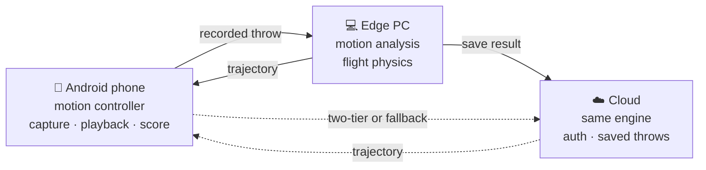

# DiscLab

**A Motion-Based Disc Golf Training Simulator**

Your phone is the disc. Aim at a real landmark, hold volume-down, throw without letting go of the phone, and let go of the button at the moment the disc would leave your hand. DiscLab analyzes the motion, simulates the flight and plays it back on a virtual hole.

## Envisioned architecture

Solid arrows are the three-tier path. Dotted arrows are the two-tier path, which is also the automatic fallback when the edge PC can't be reached.

## Status

🚧 Early development. Progress is tracked in the [milestones](https://github.com/HolyBarrel/MobEdgeCloud_Project/milestones), and the full plan is in [brainstorm-v2.md](brainstorm-v2.md).

---

University project for *Mobile, Edge and Cloud Computing*, Sapienza University of Rome.
